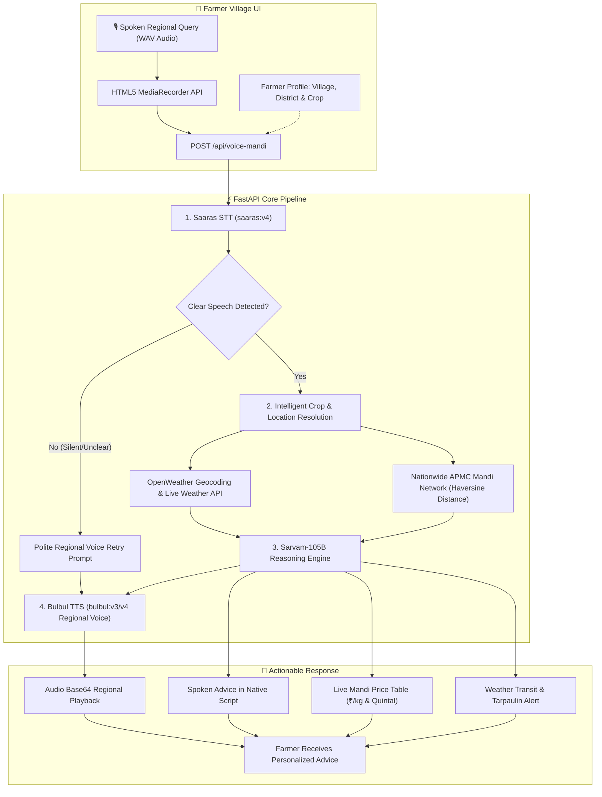

# 🌾 Voice Mandi (आवाज़ मंडी)
> **A Voice-First, Multilingual Agricultural Market & Weather Intelligence Advisor for Indian Farmers powered by Sarvam AI**

[](https://fastapi.tiangolo.com)
[](https://python.org)
[](https://sarvam.ai)
[](https://openweathermap.org)
[](https://en.wikipedia.org/wiki/Languages_of_India)
[](https://opensource.org/licenses/MIT)

---

## 🌟 Overview

**Voice Mandi (आवाज़ मंडी)** bridges the digital divide for millions of Indian farmers by providing real-time, localized market intelligence and weather advisories through **natural spoken regional languages**. 

A farmer can simply press a large, glowing microphone button, speak in their native tongue (e.g. *"आज मंडी में टमाटर का क्या भाव है?"* or *"Where is the best market to sell onions today?"*), and within seconds receive:
1. **Best Local APMC Mandi Recommendations**: Calculates genuine physical distance using geodesic coordinates across a nationwide network of Indian markets (ensuring UP farmers are quoted UP/MP mandis like Chitrakoot, Banda, and Satna—never distant states like Maharashtra).
2. **Real-time Live Weather Risks**: Dynamic temperature, sky conditions, and 24-hour rainfall probabilities from OpenWeatherMap to safeguard harvest transit.
3. **Regional Voice Playback**: Native spoken response delivered via Sarvam's Bulbul TTS in the farmer's chosen language, accompanied by price comparisons and transit protection advice.

---

## 🚀 Key Features

- 🎙️ **Voice-First & Multilingual (10 Indian Languages + English)**:
  Full voice-to-voice pipeline supporting **Hindi, Marathi, Gujarati, Kannada, Tamil, Telugu, Bengali, Punjabi, Malayalam, Odia**, and **English** with BCP-47 language codes and native regional accents.
- 📍 **Nationwide APMC Mandi Geodesic Resolution**:
  Integrated OpenWeather Direct Geocoding API + Haversine formula to compute true road/geodesic distances to surrounding APMC mandis across all states (UP, MP, Maharashtra, Gujarat, Punjab, Rajasthan, Bihar, South India, etc.).
- 🌦️ **Live Dynamic Weather Integration**:
  Real-time weather data for any entered village, district, or town. Weather alerts vary dynamically (rain risk percentage, cloud cover, drying and tarpaulin recommendations).
- 🌾 **Intelligent 16+ Crop Intelligence with Query Priority**:
  Supports **Tomato, Onion, Potato, Wheat, Rice/Paddy, Cotton, Soybean, Maize, Garlic, Chilli, Ginger, Sugarcane, Mustard, Groundnut, Gram (Chana), Turmeric**, plus custom crops. The crop mentioned in spoken queries takes top priority.
- 🛡️ **Speech Validation & Localized Fallback**:
  Detects silent or unintelligible speech and politely prompts the farmer in their selected regional language to speak clearly again.
- 📱 **Rural-Centric Responsive UI**:
  High-contrast earthy palette (**#2E7D32** Krishi Green, **#FBC02D** Harvest Gold, **#5D4037** Soil Brown), large pulsing microphone button, audio speed control (0.85x rural pace), and responsive comparison tables.

---

## 🏛️ System Architecture



---

## 🗣️ Supported Languages

| Language | Native Name | Code | Script | Sample Demo Query |
| :--- | :--- | :--- | :--- | :--- |
| **Hindi** | हिन्दी | `hi-IN` | Devanagari | आज मंडी में प्याज का क्या भाव है? |
| **Marathi** | मराठी | `mr-IN` | Devanagari | आज बाजारात कांद्याचा काय भाव चालू आहे? |
| **Gujarati** | ગુજરાતી | `gu-IN` | Gujarati | આજે માર્કેટ યાર્ડમાં ડુંગળીનો શું ભાવ છે? |
| **Kannada** | ಕನ್ನಡ | `kn-IN` | Kannada | ಇಂದು ಮಾರುಕಟ್ಟೆಯಲ್ಲಿ ಈರುಳ್ಳಿ ದರ ಎಷ್ಟಿದೆ? |
| **Tamil** | தமிழ் | `ta-IN` | Tamil | இன்று சந்தையில் வெங்காய விலை என்ன? |
| **Telugu** | తెలుగు | `te-IN` | Telugu | ఈరోజు మార్కెట్లో ఉల్లిపాయ ధర ఎంత ఉంది? |
| **Bengali** | বাংলা | `bn-IN` | Bengali | আজ বাজারে পেঁয়াজের দর কত চলছে? |
| **Punjabi** | ਪੰਜਾਬੀ | `pa-IN` | Gurmukhi | ਅੱਜ ਮੰਡੀ ਵਿੱਚ ਪਿਆਜ਼ ਦਾ ਕੀ ਭਾਅ ਚੱਲ ਰਿਹਾ ਹੈ? |
| **Malayalam** | മലയാളം | `ml-IN` | Malayalam | ഇന്ന് വിപണിയിൽ ഉള്ളി വില എത്രയാണ്? |
| **Odia** | ଓଡ଼ିଆ | `od-IN` | Odia | ଆଜି ମଣ୍ଡିରେ ପିଆଜ ଦର କେତେ ଅଛି? |
| **English** | English | `en-IN` | Latin | Where is the best market to sell tomatoes today? |

---

## 📂 Project Structure

```
voice-mandi/
├── backend/
│   ├── main.py              # FastAPI pipeline (Saaras -> Sarvam-105B -> Bulbul)
│   ├── mandi_service.py     # Nationwide APMC Mandi network, Haversine geo-distance, crop intelligence
│   ├── weather_service.py   # OpenWeather integration, geocoding & localized alerts
│   ├── languages.py         # 10 Indian language definitions, scripts & fallback prompts
│   ├── requirements.txt     # Python backend dependencies
│   ├── .env.example         # Template for required API keys
│   └── .env                 # (Ignored) Production API credentials
├── frontend/
│   ├── index.html           # Rural-themed UI with 10-language selector, profile inputs & mic
│   ├── styles.css           # Earthy Krishi colors, pulsing animations, responsive cards
│   └── app.js               # MediaRecorder voice streaming, audio playback, live weather & UI sync
├── test_sarvam.py           # Quick verification script for Sarvam AI models
├── .env.example             # Root template for environment variables
├── .gitignore               # Protects sensitive API keys and caches
└── README.md                # Comprehensive documentation
```

---

## 🛠️ Quick Start Guide

### 1. Prerequisites
- Python 3.10 or higher
- Git
- Valid [Sarvam AI API Key](https://dashboard.sarvam.ai)
- Free [OpenWeatherMap API Key](https://openweathermap.org/api)

### 2. Clone the Repository
```bash
git clone https://github.com/Arvindkumar-star/VOICE-MANDI.git
cd VOICE-MANDI
```

### 3. Setup Virtual Environment & Install Dependencies
```bash
python -m venv venv

# Windows:
venv\Scripts\activate

# Linux / macOS:
source venv/bin/activate

# Install dependencies:
pip install -r voice-mandi/backend/requirements.txt
```

### 4. Configure Environment Variables
Create a `.env` file in `voice-mandi/backend/` (or copy from `.env.example`):
```ini
SARVAM_API_KEY=your_sarvam_api_key_here
WEATHER_API_KEY=your_openweather_api_key_here
```

### 5. Launch the Application
Run the FastAPI application using Uvicorn:
```bash
python -m uvicorn main:app --app-dir voice-mandi/backend --host 0.0.0.0 --port 8000 --reload
```

Open your browser and navigate to:
👉 **`http://localhost:8000`**

---

## 🔌 API Reference

### 1. Voice Query Pipeline
`POST /api/voice-mandi`
- **Payload (`multipart/form-data`)**:
  - `file`: WAV audio blob from microphone
  - `language_code`: `hi-IN`, `mr-IN`, `te-IN`, `ta-IN`, etc.
  - `farmer_name`: (Optional) e.g. "Ramdas Patil"
  - `location`: (Optional) e.g. "Chitrakoot", "Nashik", "Surat"
  - `crop`: (Optional) e.g. "Tomato", "Wheat", "Cotton"
- **Returns**: JSON containing `user_transcript`, `ai_response` (`spoken_response`, `english_analysis`, `recommended_market`, `weather_warning`), `audio_base64`, `raw_prices`, `weather`.

### 2. Text / Simulation Query
`POST /api/text-mandi`
- **Payload (`application/json`)**:
  ```json
  {
    "query": "Where is the best market to sell tomatoes today?",
    "language_code": "en-IN",
    "farmer_name": "Arvind",
    "location": "Chitrakoot",
    "crop": "Tomato"
  }
  ```

### 3. Live Weather Endpoint
`GET /api/weather?location=Chitrakoot`
- Returns live temperature, condition, humidity, 24-hour rain risk percentage, and badge text.

### 4. Supported Languages
`GET /api/languages`
- Returns all 10 supported Indian languages with BCP-47 codes, native names, and scripts.

---

## 💡 Real-World Scenarios Solved

| Scenario | Farmer Input | Voice Mandi Output |
| :--- | :--- | :--- |
| **Bundelkhand / UP Farmer** | Location: *Chitrakoot (UP)*<br>Query: *"आज प्याज का क्या भाव है?"* | Recommends **Chitrakoot Karwi Mandi (5 km)**, **Banda (64 km)**, and **Satna (66 km)**. Zero routing to Mumbai or Pune. |
| **Crop Specificity** | Profile: *Onion* (stale)<br>Query: *"Where to sell tomatoes today?"* | Intelligently overrides to **Tomato** (`₹22/kg`). Zero mention of onion in advice. |
| **Rain Hazard Protection** | Location: *Pune Rural*<br>Query: *"क्या आज माल ले जाना सुरक्षित है?"* | Evaluates live rain risk from OpenWeather and recommends covering harvest with a tarpaulin during transit. |
| **Silent / Noisy Mic** | Empty / Unclear Audio | Speaks back politely in native language: *"माफ़ कीजिए, आपकी आवाज़ साफ़ सुनाई नहीं दी। दोबारा बोलें।"* |

---

## 📄 License

This project is licensed under the MIT License - see the [LICENSE](LICENSE) file for details.

---

## 🙏 Acknowledgements

- [Sarvam AI](https://sarvam.ai) for state-of-the-art Indic AI models: **Saaras STT**, **Sarvam-105B**, and **Bulbul TTS**.
- [OpenWeatherMap](https://openweathermap.org) for real-time global weather and direct geocoding APIs.
- Indian agricultural APMC mandi networks for price benchmark transparency.
